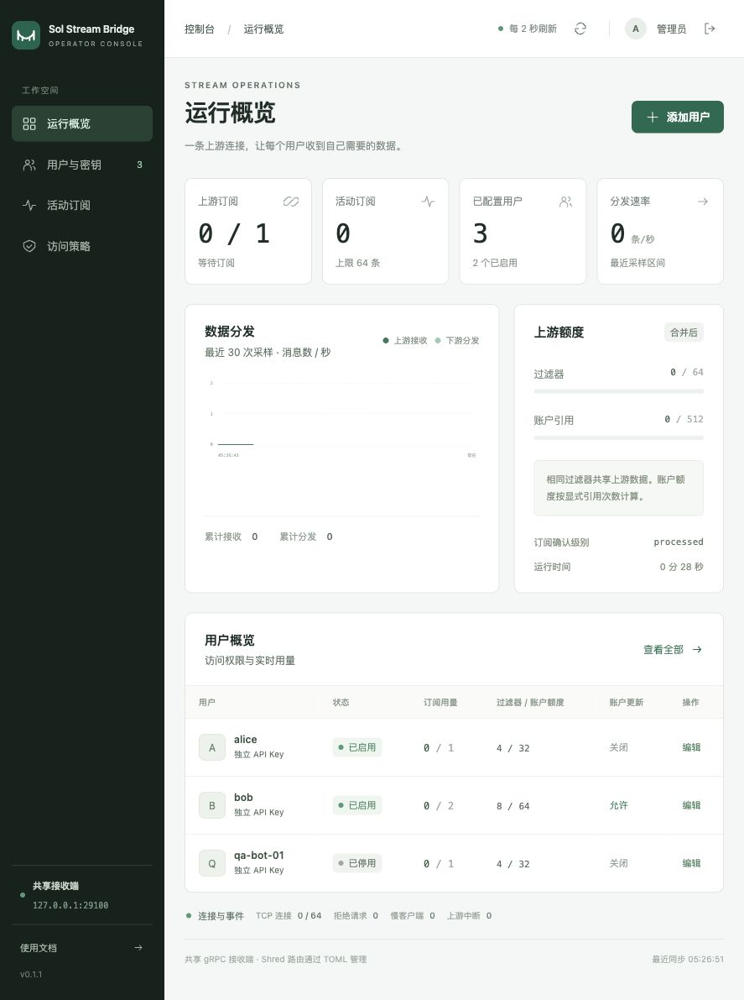

<div align="center">
  <h1>Sol Stream Bridge</h1>
  <p>Solana Shred and Yellowstone gRPC forwarding with Rust, Go and TypeScript bot clients</p>
  <a href="https://github.com/0xfnzero/sol-stream-bridge/releases"></a>
  <a href="https://crates.io/crates/stream-bridge-client"></a>
  <a href="https://www.npmjs.com/package/stream-bridge-client"></a>
  <a href="LICENSE"></a>
</div>

<p align="center">
  <a href="https://fnzero.dev">Website</a> ·
  <a href="README.md">English</a> · <a href="README_CN.md">中文</a> ·
  <a href="clients/README.md">Bot clients</a> ·
  <a href="docs/DEPLOYMENT.md">Deployment</a> ·
  <a href="RELEASE_NOTES.md">Releases</a>
</p>

**Sol Stream Bridge** is a Rust forwarding bridge for Solana Shred UDP and Yellowstone gRPC streams. Forward Jito ShredStream proxy output, raw Shred sent to an IP and port, and Yellowstone Geyser subscriptions to another server. Run Shred and gRPC together or separately over public or reachable private networks; Rust, Go and TypeScript bot SDKs deliver raw packets and decoded updates to your trading bot.

**Server:** `stream-bridge-server` · **Bot SDK (Rust/npm):** `stream-bridge-client` · **Go module:** `github.com/0xfnzero/stream-bridge/clients/go`

Go imports retain the original module path for compatibility with published versions.

Current release: **[v0.1.1](https://github.com/0xfnzero/sol-stream-bridge/releases/tag/v0.1.1)**. Server binaries and all three Bot clients use version **0.1.1**. See [release notes](RELEASE_NOTES.md) for fixes and upgrade instructions.

## Contents

- [Features](#features)
- [Shared subscriptions and API Keys](#shared)
- [React dashboard](#dashboard)
- [Script installation](#installation)
- [Configuration and startup](#quick-start)
- [Private networks](#private-network)
- [Bot clients](#clients)
- [Runtime behavior](#behavior)
- [Development](#development)
- [Related projects](#related)

<a id="features"></a>
## Features

1. Multiple UDP listeners and destinations; forwards original Shred payloads without changing datagram boundaries.
2. Accepts Jito proxy UDP output and raw Shred pushed directly to an IP and port.
3. Default passthrough reverse TCP tunnels preserve Yellowstone HTTP/2, bidirectional subscriptions, filter updates, ping, metadata and x-token.
4. Receiver-side gRPC IP allowlists reject unauthorized clients before opening an upstream tunnel. Empty lists deny everyone.
5. Public-network templates use TLS and shared-token authentication. The source's Yellowstone port need not be public.
6. Trusted private-network templates use plaintext TCP with shared tokens and client IP allowlists; Shred uses UDP.
7. Rust and Go channels / TypeScript async iterators deliver raw Shred; all three expose typed Yellowstone updates.
8. Prebuilt installers, checksum verification, configuration-preserving upgrades, optional systemd service, counters and connection limits.

<a id="shared"></a>
## Shared subscriptions and API Keys (unreleased)

Source on `main` adds **one upstream subscription for multiple users**, optional API Keys (`x-token` or `x-api-key`), IP checks, per-user quotas and account-update permissions. Released **v0.1.1 does not include these features**. Build from source; see the [complete configuration and operating guide](docs/SHARED.md).

Add to receiver B's configuration (keep its existing tunnel fields):

```toml
[grpc]
# Existing tunnel/listen/TLS fields remain here.
allowed_sources = ["127.0.0.1", "10.0.0.30"]
api_keys = { alice = "replace-with-random-secret" } # {} disables key checks

[grpc.shared]
upstream_endpoint = "http://yellowstone"
# upstream_x_token_env = "YELLOWSTONE_X_TOKEN" # provider token, on B only
max_subscriptions_per_key = 1
max_filters = 64
max_accounts = 512
allow_accounts = false
allow_unfiltered = false
metrics_listen = "127.0.0.1:9090"

[grpc.shared.users.alice]
max_subscriptions = 1
max_filters = 4
max_accounts = 32
allow_accounts = false
```

The Bot sends Alice's key; the provider credential stays on B. IP and Key checks both apply. `{}` or all-empty keys disable only Key checks. Account/owner updates are disabled by default, with per-user opt-in. User filter/account caps apply across that user's streams; upstream caps apply after deduplicating identical filters. Limits should match your provider's plan.

For a provider limited to one connection, also set `[grpc] max_connections = 1` on source A to bound connections during teardown/reconnect. Use `http://IP:port` on trusted private networks. Client-facing TLS is optional and independent of tunnel/provider TLS. Full example: [config.shared-receiver.toml](config.shared-receiver.toml). Omit `[grpc.shared]` to retain TCP passthrough. Shared mode supports Subscribe/Ping/GetVersion with a fixed commitment; other RPCs, replay and data slices are outside its current scope.

<a id="dashboard"></a>
## React operator dashboard (unreleased)

`main` includes a React + TypeScript dashboard for shared gRPC operators: live connection and delivery statistics, user key creation/rotation/disable, subscription and account quotas, account-update permission, IP allowlists and individual stream disconnects. Changes persist and apply live; revisions prevent stale edits from overwriting newer settings.

Run `./setup-dashboard.sh` on the shared receiver, enable `[grpc.shared.dashboard]` as instructed, and start the server. The default URL is `http://127.0.0.1:8080`; use SSH forwarding for remote access. Shred routes and global upstream settings remain in TOML. **Published v0.1.1 does not include this feature.** See [dashboard setup, credentials and backups](docs/DASHBOARD.md).

Setup prints a random nine-character username and initial password once in the terminal. The login page supports password show/hide; first login requires a password change. Later changes require the current password and revoke all dashboard sessions without affecting Bot keys or streams. Saved passwords use Argon2id hashes.



Local test environment; no production upstream attached.

<a id="installation"></a>
## Script installation

Prebuilt server packages are provided for **Linux x86_64 / arm64 (glibc 2.35+)**. The installer selects the matching binary; users do not need Rust. macOS and Alpine/musl binaries are not included in v0.1.1 or later releases.

On receiver B:

```bash
curl -fsSL -o install.sh https://github.com/0xfnzero/sol-stream-bridge/releases/latest/download/install.sh
chmod +x install.sh
ROLE=receiver ./install.sh
cd "$HOME/stream-bridge"
```

Download the same installer on source A, then:

```bash
ROLE=source ./install.sh
cd "$HOME/stream-bridge"
```

Roles: `source`, `receiver`, `shred-only`, `private-source`, `private-receiver`. Receiver setup requires `openssl`: `receiver` creates a token and a self-signed TLS certificate; `private-receiver` creates only a token. Configure addresses and share credentials before starting.

Pin a version or directory:

```bash
VERSION=v0.1.1 ROLE=source INSTALL_DIR=/opt/stream-bridge ./install.sh
```

The directory must be writable. Unmanaged directories are never replaced. Upgrades preserve root TOML files (including dashboard state and password hashes), `.bridge-token`, `.dashboard-initial-credentials`, legacy `.dashboard-token` and `certs/`; the previous installation is retained as `.backup.*`. Restart the process after upgrading. Backups contain credentials and must be protected accordingly.

<a id="quick-start"></a>
## Configuration and startup

### Receiver B

Edit `config.toml`. The generated receiver template listens for tunnels on `0.0.0.0:19000`, serves local bots on `127.0.0.1:10000`, and permits `127.0.0.1` in `grpc.allowed_sources`.

For remote bots, bind `grpc.listen` to the intended interface and add their actual source IPs. **An omitted or empty gRPC allowlist denies all clients.**

Securely copy `.bridge-token` and `certs/tunnel-cert.pem` to the same paths on source A. Keep `tunnel-key.pem` on B. `run.sh` reads the token as data, never as shell code; an exported `BRIDGE_TOKEN` takes precedence.

### Source A

Edit `config.toml`: replace `203.0.113.10` with B's public or private IP, update raw Shred provider IPs, and set `grpc.upstream` to your local Yellowstone `host:port`.

The tunnel's `server_name` must match its certificate SAN. Receiver setup uses `bridge.example.com` by default; DNS resolution is not required because `tunnel_address` supplies the IP. Use `TLS_NAME=your.domain ROLE=receiver ./install.sh` to generate a different certificate name.

The default Jito route receives UDP on `127.0.0.1:20000`; set your proxy's `--dest-ip-ports` accordingly. Raw Shred arrives on `0.0.0.0:20001`. B must run a UDP consumer or forwarding route on the configured destination ports.

### Start

Start B first, then A:

```bash
./run.sh --check
./run.sh
```

For an alternate configuration: `./run.sh configs/config.shred-only.toml` after editing its destinations. UDP-only mode needs no tunnel token or certificate. Relative paths resolve from the installation directory. Restart to apply changes.

Optional Linux systemd service:

```bash
sudo ./install-service.sh
sudo systemctl restart stream-bridge-server
sudo journalctl -u stream-bridge-server -f
```

The service runs as the invoking sudo user and reads `.bridge-token`. Use `./run.sh` for foreground execution and Ctrl+C to stop.

<a id="private-network"></a>
## Private networks

Install A/B with `ROLE=private-source` and `ROLE=private-receiver`. Replace example addresses `10.0.0.10`, `10.0.0.20` and client `10.0.0.30`. The private receiver forwards UDP `20000/20001` to local bot ports `21000/21001`; gRPC clients use B's private `10000/TCP`.

Both private templates set `grpc.insecure = true`: the tunnel uses plaintext TCP to B's private IP and port, with no certificate or domain required. Securely copy B's `.bridge-token` to A; shared tokens and client IP allowlists remain enabled. Use these templates only on a controlled, trusted network. Public-network `source` / `receiver` templates retain TLS.

Starting with v0.1.1, private templates default to plaintext TCP; v0.1.0 private templates use TLS. Upgrades preserve active configurations. To switch an existing trusted-private deployment, set `insecure = true` in `[grpc]` on **both** machines, run `./run.sh --check` and restart both processes. Old TLS fields are ignored in this mode; credentials are not deleted.

Being in the same region does not guarantee connectivity: use a reachable VPC, peering or VPN. The bridge uses system routing, does not create cloud networks, and does not silently fall back to a public IP. For a plaintext Yellowstone upstream, bots use `http://B_PRIVATE_IP:10000`; an upstream requiring TLS still needs `https://` and its own certificate validation. See [deployment details](docs/DEPLOYMENT.md) for authentication and transport choices.

<a id="clients"></a>
## Bot clients

Install the SDK directly into your Bot project from [crates.io](https://crates.io/crates/stream-bridge-client), [Go modules](https://pkg.go.dev/github.com/0xfnzero/stream-bridge/clients/go) or [npm](https://www.npmjs.com/package/stream-bridge-client):

```bash
# Rust: raw Shred and typed Yellowstone updates
cargo add stream-bridge-client@0.1.1 --features yellowstone
# Go
go get github.com/0xfnzero/stream-bridge/clients/go@v0.1.1
# Node.js / TypeScript
npm install stream-bridge-client@0.1.1
```

See [client integration](clients/README.md) for API examples and lifecycle handling. All three standalone source examples use `clients/client.toml`:

```bash
cargo run --locked --example receive --features yellowstone -- clients/client.toml
(cd clients/go && go run ./examples/receive ../client.toml)
(cd clients/typescript && npm ci && npm run receive -- ../client.toml)
```

Rust can embed the receiver inside a Bot process. Go and TypeScript clients connect to the running Rust receiver. Clients deliver raw Shred bytes with source/timestamp and typed Yellowstone transaction, account, slot and other supported updates. The npm package also includes a receiver CLI: `npx stream-bridge-client@0.1.1 /path/to/client.toml`. SDKs receive data inside your Bot; the bridge service is installed separately.

<a id="behavior"></a>
## Runtime behavior

- UDP is best effort. No Shred reconstruction, FEC, deduplication or transaction decoding is performed. Full Bot queues drop new packets and count them.
- The upstream Jito proxy handles its own authentication and subscription. This tool consumes available UDP output; it cannot restore discontinued upstream services.
- gRPC data follows client subscriptions. Idle tunnels reconnect automatically; interrupted subscriptions must be reopened by the Bot. No historical replay is performed.
- `BRIDGE_TOKEN` authenticates the bridge tunnel, not Yellowstone clients. In passthrough, client encryption follows upstream TLS. In shared mode, receiver `client_tls` controls it.
- Allowlists check the socket peer IP. Behind NAT, use the translated address; through a proxy, only the proxy IP is visible.
- See [deployment details](docs/DEPLOYMENT.md) for ports, TLS, queues and operating limits.

<a id="development"></a>
## Development

- `src/`: Rust bridge and Bot client APIs.
- `clients/go/`, `clients/typescript/`: clients and runnable examples.
- `examples/`: Rust receiver and embedded-Bot examples.
- `install.sh`, `setup.sh`, `run.sh`: installation, initialization, startup.
- `.github/workflows/`: tests, Linux x86_64 / arm64 releases, client publication.

```bash
cargo test --all-features --locked
cargo clippy --all-targets --all-features --locked -- -D warnings
(cd clients/go && go test -race ./...)
(cd clients/typescript && npm ci && npm test)
python3 tools/smoke_clients.py
python3 tools/smoke_clients.py --plaintext
python3 tools/smoke_clients.py --shared
python3 tools/smoke_clients.py --shared --plaintext
python3 -m unittest discover -s tests -p 'test_install.py'
```

The smoke test uses a local mock Yellowstone and real source/receiver processes. It checks Shred, slot and transaction delivery plus shutdown for all three examples over TLS by default, or plaintext TCP with `--plaintext`. Configure a live upstream separately for production verification.

<a id="related"></a>
## Related projects

- [sol-trade-sdk](https://github.com/0xfnzero/sol-trade-sdk): Solana DEX transaction construction and submission.
- [sol-parser-sdk](https://github.com/0xfnzero/sol-parser-sdk): transaction and account event parsing.
- [sol-shred-sdk](https://github.com/0xfnzero/sol-shred-sdk): raw Shred decoding.
- [grpc-benchmark](https://github.com/0xfnzero/grpc-benchmark): gRPC and Shred latency measurement.
