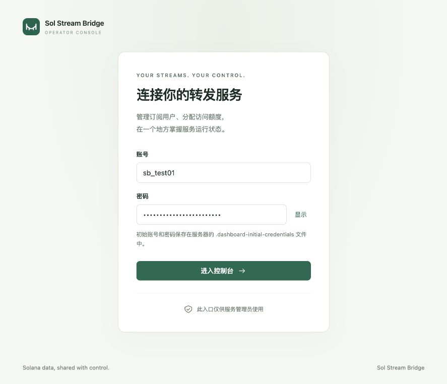

# React operator dashboard

[中文](DASHBOARD_CN.md) · [Shared subscriptions](SHARED.md) · [Home](../README.md)

Included in **v0.2.0 Linux packages**. The React + TypeScript dashboard runs on shared Yellowstone receiver B; Rust serves the static assets and management API in the same process.

## Controls

- Live upstream/downstream connections, subscriptions, per-user usage, merged filters/account references, message rates, rejected requests, slow clients and upstream failures.
- Create users with random API keys; edit combined subscription/filter/account quotas and account-update permission; enable, disable, rotate keys and delete users.
- Inspect up to 200 active Subscribe streams with peer IP, start time and queued deliveries; disconnect a stream or disable a user to terminate all their streams.
- Manage the exact-IP allowlist and a separate **require API key** switch. When enabled, both checks must pass. When disabled, identities and quotas use the source IP.

Shred routes, passthrough mode, listeners, TLS, provider credentials and global upstream limits remain in TOML. This dashboard manages shared gRPC, not every forwarding topology. Rates count messages received/enqueued, not network bytes, Bot processing acknowledgements or end-to-end latency. Chart history exists only in the current page's memory.

## Install and start

Configure the source A / receiver B tunnel following [shared mode deployment](SHARED.md). Install B with `VERSION=v0.2.0 ROLE=shared-receiver ./install.sh`, then run the following in its installation directory (or the repository directory for source deployments):

```bash
# Source asset builds require Node.js >=22.12 and npm; credential generation needs openssl.
./setup-dashboard.sh
```

Source checkouts rebuild the dashboard on every setup run, including after `git pull`, so the login page matches the server. Prebuilt release packages use their bundled assets without Node.js.

After assets are ready, the script generates a short random username (`sb_` plus six hex characters, nine characters total) and a random initial password. It prints both **once in the successful setup terminal** and saves them as two lines in `.dashboard-initial-credentials` (mode 600): username first, password second. Rerunning setup preserves existing credentials without printing the password again. The public login page never reveals initial credentials; its show/hide button controls only the password you enter.

To choose your own initial username, run `DASHBOARD_INITIAL_USERNAME=my_bridge ./setup-dashboard.sh` before the first setup. Usernames must be 3–64 ASCII letters, digits, dots, underscores or hyphens; `admin`, `administrator` and `root` are rejected. Add this table once to the shared receiver's active configuration:

```toml
[grpc.shared.dashboard]
listen = "127.0.0.1:8080"
auth_file = "dashboard-admin.toml"
# Optional overrides for initial-credential environment variable names:
# initial_username_env = "DASHBOARD_INITIAL_USERNAME"
# initial_password_env = "DASHBOARD_INITIAL_PASSWORD"
state_file = "dashboard-state.toml"
assets_dir = "dashboard/dist"
```

A commented example is included in `config.shared-receiver.toml`. New installations may run `./setup.sh shared-receiver` to prepare a configuration and tunnel credentials; existing `config.toml` is preserved rather than switched automatically. Customize the example keys, IPs, upstream and tunnel settings, then:

```bash
cargo build --release --locked # source deployments only; skip for prebuilt packages
./run.sh config.shared-receiver.toml --check
./run.sh config.shared-receiver.toml
```

**Prebuilt installations use the root `config.toml`**: run `./run.sh --check` and `./run.sh` without the example filename above; templates live in `configs/`. Source deployments using `config.toml` also omit the filename. `run.sh` reads the two lines as data into `DASHBOARD_INITIAL_USERNAME` and `DASHBOARD_INITIAL_PASSWORD`; exported values take precedence. Export your own variables when changing the environment names above. Direct binary execution also needs those variables for the first startup. Run from the project/install directory: configured paths are relative to the working directory. `--check` validates setup without creating an account.

Open [http://127.0.0.1:8080](http://127.0.0.1:8080), enter the initial credentials, and **change the password before accessing the console**. New passwords need at least 12 characters, at most 128 UTF-8 bytes and no control characters. Later changes use the key button in the console header and require the current password plus confirmation of the new password. Every successful password change revokes all dashboard sessions and requires login again; Bot keys and forwarding streams are unaffected.

The first actual startup saves an Argon2id password hash in `dashboard-admin.toml` (mode 600, atomically written and exclusively locked). Initial environment values are ignored once this file exists. After changing the initial password you may remove `.dashboard-initial-credentials`; it is not the current password store. Corrupt or insecure credential files fail closed instead of resetting the account.

v0.2.0 Linux packages include `dashboard/dist` and the setup script, requiring no Node.js at runtime. Upgrade v0.1.1 binaries before enabling shared mode or dashboard configuration.



Local test account shown; initial credentials are never displayed on the login page.

## Remote administration

The listener must use loopback. Forward it through SSH:

```bash
ssh -N -L 8080:127.0.0.1:8080 user@RECEIVER_IP
```

Visit `http://127.0.0.1:8080` locally. For an occupied local port, use `-L 18080:127.0.0.1:8080` and visit port 18080. Admin HTTP travels inside SSH and does not change the Bot, provider or bridge transport. Only localhost/127.0.0.1/::1 Host values are accepted; cross-origin browser requests are rejected.

Dashboard credentials are independent of user keys, `BRIDGE_TOKEN` and provider `x-token`. Login issues a random session token held only in browser memory, never localStorage, cookies or URLs; the server keeps its hash. Sessions expire after eight hours. Refreshing requires login again, logout revokes that session, and a server restart clears all sessions. Password changes revoke every session without restarting. Login/password changes share a global limit of ten attempts per minute and one password-hashing worker; Only the 32 most recent sessions are retained; a further successful login revokes the oldest session.

## Migration and account recovery

For an earlier main-branch dashboard using `DASHBOARD_TOKEN`, run setup and replace **only** `[grpc.shared.dashboard].token_env` with the `auth_file` configuration above. The old administrator token no longer logs in. Keep `dashboard-state.toml` and bridge/provider token settings intact.

For a forgotten password, stop the server, securely back up and move the configured `auth_file` and `.dashboard-initial-credentials` out of the installation, then rerun setup and restart. This creates a new initial account requiring a password change. Keep `dashboard-state.toml` intact to preserve Bot keys and policies. After recovery, protect or securely remove the old credential backups. Changing bootstrap environment values alone never resets an existing account.

## User lifecycle

1. Create a user and assign quotas. A new key is returned once after creation/rotation; rotate again if lost.
2. Explicitly enable **require API key** if currently off. Creating a user does not change this switch. Nonempty TOML keys enable it on initial setup.
3. Give the user key to the Bot via the v0.2.0 client `api_key` or Yellowstone `x-token` / `x-api-key` metadata. Never distribute dashboard credentials or sessions.
4. Per-user quotas combine all that user's streams and remain subject to per-stream/global upstream limits. Account updates require explicit permission.

Each quota and the account-update permission can **inherit the service default** or use a user-specific override. New users inherit by default; editing preserves this choice. Inheriting keeps the separate per-stream and cumulative defaults (for example, 8 filters per stream and 16 across the user). A custom filter/account limit applies to both the stream and the user's combined usage. Turning inheritance off and back on preserves the custom draft until you close the form.

User key, quota, enable/disable and deletion changes terminate that user's existing subscriptions. Other users continue. Removing an IP terminates its streams. Changing authentication mode terminates all streams. Bots must handle stream termination and resubscribe. Disconnecting a stream allows reconnecting; disable the user/remove its IP to block future admissions. HTTP/2 TCP connections may remain idle after Subscribe ends, so the TCP counter need not immediately drop.

Deleting/disabling the last key **does not disable authentication**. An empty allowlist denies all gRPC clients. With key checks off, identities are `ip:<peer-IP>` and named key-user quotas do not apply; existing TOML `grpc.shared.users."ip:..."` profiles can be edited in the dashboard. Do not allocate user keys to these IP profiles.

## Persistence and backups

TOML `grpc.api_keys`, `grpc.allowed_sources` and `grpc.shared.users` seed the first run. After the first successful management save, `dashboard-state.toml` becomes authoritative for these settings, including after restart. The original TOML is not rewritten; it still controls all other settings.

The state contains plaintext user keys. It must be a regular file with no Unix group/other access (use mode 600). Writes are atomic, and multiple servers cannot manage the same state file. External edits, corruption or unsafe permissions cause save/startup failures instead of falling back to old keys. Snapshot API responses never expose keys.

Back up `dashboard-state.toml`, `dashboard-admin.toml`, active configuration, any retained `.dashboard-initial-credentials`, `.bridge-token` and tunnel credentials with restricted access. Installer upgrades preserve root TOML files, credential files and certificates, including the legacy `.dashboard-token`. Back up custom external paths yourself. Deleting state and restarting reactivates the original TOML users/keys; do not use deletion as a UI reset. Also reconcile TOML policy before disabling the dashboard or downgrading binaries.

Writes include a revision. Stale edits return 409 instead of overwriting another administrator's changes. User forms offer “Load latest settings” after a revision conflict; this explicitly replaces the draft. Reload access policies before retrying. A disconnected/timed-out write may have committed; refresh first. If a creation/rotation response is lost, rotate again to obtain a known key.

Once state is persisted, saving identical user settings or access policies does not rewrite the file, advance the revision or interrupt subscriptions. Revision and file-integrity checks still apply. The first successful save always creates durable state, even if its values match TOML. User forms and access-policy navigation/logout warn before discarding a draft; reloading or closing the browser tab also requests confirmation when the browser permits it.

## Development

```bash
cd dashboard
npm ci
npm run build
npm test
npm run dev # loopback :5173, /api proxies to a running Rust dashboard on :8080
```

The frontend polls every two seconds while visible, pauses in background tabs, and refreshes when you return. Concurrent reads share one request; a successful save starts a fresh read so an older response cannot overwrite it. Expired sessions return to login. User lists show 25 rows per page; search covers all users. One-time API Key dialogs require explicit acknowledgement before closing. Persistence and password hashing use blocking workers outside the forwarding lock. Disabled dashboards load no assets and open no management listener. Production traffic latency benchmarks have not been performed.
